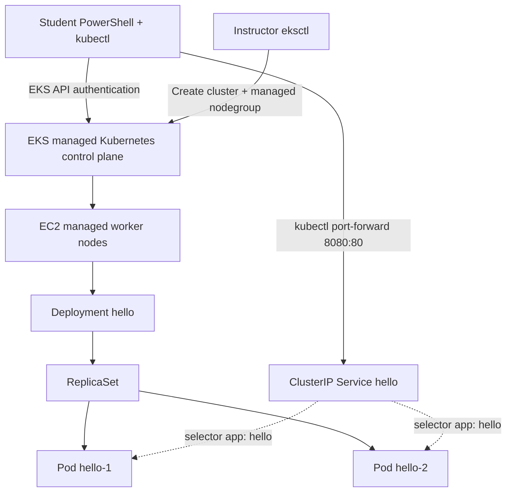

# Practical DevOps Cohort 4 — Provision, Deploy, Observe, Recover

**Duration:** 2-hour application lab **after cluster provisioning** (allow an additional 30–60+ minutes for cluster creation and troubleshooting)  
**Terminal:** Windows PowerShell 5.1 or PowerShell 7  
**Cloud:** Amazon EKS, provisioned using `eksctl`  
**Application:** Google's open-source `hello-app` (no database or Google Cloud account required)

> **Driving question:** Can you provision a Kubernetes cluster, deploy a web application, change its version, and recover it when something goes wrong?

This guide retains the original Cohort 4 deployment, update, rollback, scale, self-healing, troubleshooting, evidence, and cleanup exercises. **New:** the instructor first provisions the EKS cluster with `eksctl` so the deployment is not dependent on an unexplained pre-existing cluster.

## How to learn with this repository

- Work in pairs: one person operates, the other predicts and checks; swap halfway through.
- Read the question before each command. Record what actually happened in `EVIDENCE.md`.
- Inspect YAML before applying it. Explain *why* a command works, not only what it prints.
- Never paste access keys, kubeconfig, private keys, or unredacted account details into submissions.
- Instructor owns shared-cluster creation, billing, access grants, and deletion. Students work only in assigned namespaces.

## Repository layout

```text
README.md                   This complete lab
infra/eksctl-cluster.yaml   Cluster configuration (create from example below)
k8s/deployment.yaml         Web app Deployment (existing file)
k8s/service.yaml            Internal ClusterIP Service (existing file)
EVIDENCE.md                 Student observation template (existing file)
.gitignore                  Excludes credentials and scratch files (existing file)
```

> **Repository note:** The `infra/eksctl-cluster.yaml` content is included below; save it as a separate file. Keep the existing `k8s/` manifests and `EVIDENCE.md` unchanged unless the instructor intentionally updates them.

## Architecture



`kubectl port-forward service/hello` tunnels to one selected Pod; it **does not** demonstrate Service load balancing. A Deployment uses a ReplicaSet to maintain the desired number of Pods. EKS control plane and EC2 worker nodes are separately billed resources.

## Today's route

| Time | Activity | Question |
|---|---|---|
| **Pre-lab: 30–60+ min** | Instructor: create EKS with `eksctl`; grant access; create namespaces | Where does Kubernetes run? |
| 0–12 min | Welcome and introductions | What would you like to operate confidently? |
| 12–25 min | Revision in pairs | Who recreates a deleted Pod? |
| 25–32 min | Read the architecture | How does a request reach the app? |
| 32–45 min | Access and prerequisite checks | Are we using the correct cluster? |
| 45–65 min | Deploy and access | Why do labels matter? |
| 65–85 min | Update and undo | What changes a Deployment revision? |
| 85–108 min | Scale, self-heal and diagnose | Does replacement mean the same Pod returns? |
| 108–120 min | App cleanup and reflection | Which resources still cost money? |

---

# Part A — Provision the EKS cluster with eksctl (instructor-led)

## A1. Understand the infrastructure

`eksctl` is a CLI that creates and manages Amazon EKS resources. In this lab it provisions an EKS control plane, networking and a **managed EC2 node group**. EKS is not free: expect control-plane charges, EC2 instances, EBS volumes, public IPv4 charges and potentially NAT/data-transfer charges. **Do not start provisioning without budget approval.**

Use a dedicated sandbox AWS account, an approved IAM identity, and a region allowed by the instructor. For a shared class, **create one cluster and assign namespaces**, rather than having every student create an expensive cluster.

### Tools to install on the instructor's Windows workstation

Install **AWS CLI v2**, **kubectl**, and **eksctl** from their official installation documentation, then open a *new* PowerShell terminal and verify:

```powershell
aws --version
kubectl version --client
eksctl version
```

Official instructions: [AWS CLI](https://docs.aws.amazon.com/cli/latest/userguide/getting-started-install.html), [kubectl for EKS](https://docs.aws.amazon.com/eks/latest/userguide/install-kubectl.html), [eksctl](https://eksctl.io/installation/). Use a `kubectl` minor version compatible with your EKS Kubernetes version. Docker is **not required** to deploy this public sample image.

### AWS identity and region checks

```powershell
$env:AWS_REGION = "us-east-1"        # Replace with approved region
$EKS_CLUSTER = "cohort4-eks"

# If using an existing AWS IAM Identity Center profile:
# $env:AWS_PROFILE = "YOUR_CONFIGURED_PROFILE"
# aws sso login --profile $env:AWS_PROFILE

aws sts get-caller-identity
aws configure get region
aws eks list-clusters --region $env:AWS_REGION
```

Confirm the AWS account ID **privately with the instructor**. Stop if `aws sts get-caller-identity` fails. Cluster creation requires approved EKS, EC2, IAM, VPC and CloudFormation permissions; do not attempt to bypass organizational restrictions.

**If STS/DNS fails:** before running `eksctl`, verify DNS resolution, internet/proxy access and your AWS login. For example:

```powershell
Resolve-DnsName sts.us-east-1.amazonaws.com
Test-NetConnection sts.us-east-1.amazonaws.com -Port 443
aws sts get-caller-identity --region $env:AWS_REGION
```

A failure here is an AWS connectivity/identity issue, not a Kubernetes manifest issue.

## A2. Define the cluster as code

Create `infra/eksctl-cluster.yaml` (the **region and cluster name below must match the variables used in subsequent commands**):

```yaml
apiVersion: eksctl.io/v1alpha5
kind: ClusterConfig

metadata:
  name: cohort4-eks
  region: us-east-1

managedNodeGroups:
  - name: cohort4-workers
    instanceType: t3.medium
    desiredCapacity: 2
    minSize: 2
    maxSize: 3
    volumeSize: 30
    privateNetworking: false
    labels:
      cohort: "4"
```

**Teaching notes:** `managedNodeGroups` delegates node lifecycle integration to EKS. Two `t3.medium` nodes are a small *lab* baseline, not a production sizing recommendation. This example uses `eksctl` defaults for VPC/subnets and public node networking; it can create chargeable networking resources. For production, design private nodes, restricted endpoint access, encryption, network controls, and access management deliberately. `eksctl` selects a supported Kubernetes version when `metadata.version` is omitted; verify the actual version after creation. Do not put passwords or static AWS keys in this YAML.

## A3. Preview and create

First inspect the YAML and verify that the cluster name does not already exist:

```powershell
Get-Content .\infra\eksctl-cluster.yaml
aws eks describe-cluster --name $EKS_CLUSTER --region $env:AWS_REGION
```

If the cluster already exists, **do not create another**. If the describe command returns `ResourceNotFoundException`, the instructor can proceed:

```powershell
eksctl create cluster -f .\infra\eksctl-cluster.yaml
```

Creation can take 15–30+ minutes. `eksctl` provisions AWS resources via CloudFormation. Watch the terminal for failures; do not rerun the creation command blindly if it times out.

### Verify cluster and nodes

```powershell
aws eks describe-cluster --name $EKS_CLUSTER --region $env:AWS_REGION --query "cluster.{name:name,status:status,version:version,endpoint:endpoint}" --output table
aws eks update-kubeconfig --region $env:AWS_REGION --name $EKS_CLUSTER
kubectl config current-context
kubectl get nodes -o wide
kubectl get pods -n kube-system
```

**Checkpoint:** cluster status is `ACTIVE`, both EC2 nodes report `Ready`, and core system Pods are running. If the nodes do not become Ready, investigate nodegroup status, VPC/subnet routing, quotas, IAM, image pulls and available IPs.

## A4. Prepare shared student namespaces and access

**Instructor only:** create a namespace per team:

```powershell
kubectl create namespace c4-team01
kubectl create namespace c4-team02
kubectl get namespaces
```

Do **not** give all students cluster-admin. Grant each student's approved IAM role/user EKS access using an access entry and an appropriate namespace-scoped Kubernetes RBAC role/binding. The following is an **illustrative RBAC permission set**, not a complete identity grant; replace the principal and team details with your actual setup:

```yaml
apiVersion: rbac.authorization.k8s.io/v1
kind: Role
metadata:
  name: cohort4-lab
  namespace: c4-team01
rules:
  - apiGroups: ["", "apps"]
    resources: ["pods", "pods/log", "pods/portforward", "services", "endpoints", "deployments", "replicasets"]
    verbs: ["get", "list", "watch", "create", "update", "patch", "delete"]
  - apiGroups: [""]
    resources: ["events"]
    verbs: ["get", "list", "watch"]
```

Create an appropriate `RoleBinding` to the Kubernetes group mapped to that team's EKS access entry. The instructor should test access with the student's actual identity. For access entry guidance see [EKS access entries](https://docs.aws.amazon.com/eks/latest/userguide/access-entries.html). Namespace boundaries alone are not full multi-tenant isolation; add quotas and network policies as needed.

## A5. Common cluster-creation issues

| Symptom | Investigation |
|---|---|
| `aws sts` cannot resolve/connect | DNS, proxy/VPN, internet access, AWS profile and STS endpoint |
| `AccessDenied` | Approved IAM permissions and organization SCPs; ask instructor |
| CloudFormation rollback | Inspect failed stack events; correct root cause before retrying |
| EC2 quota/capacity failure | Regional vCPU quota, instance availability and nodegroup size |
| EKS API timeout | Endpoint public/private mode, public egress IP allowlist, VPN/routing and DNS |
| `Unauthorized` / `Forbidden` | AWS identity, EKS access entry and namespace RBAC |
| Nodes not `Ready` | Nodegroup status, subnets/routes, node IAM, DNS and system Pods |
| Image pull errors | Image/tag, public registry connectivity and outbound routing |

---

# Part B — Student application lab (original learning path retained)

## 1. Prove you are in the right place

**Think:** What could happen if you deploy into the wrong cluster or namespace?

In PowerShell window A:

```powershell
$env:AWS_REGION = "us-east-1"
$EKS_CLUSTER = "cohort4-eks"
$NS = "c4-team01" # Replace with YOUR assigned namespace

aws --version
kubectl version --client
aws sts get-caller-identity
aws eks update-kubeconfig --region $env:AWS_REGION --name $EKS_CLUSTER
kubectl config current-context
kubectl -n $NS auth can-i create deployments.apps
kubectl -n $NS auth can-i create services
kubectl -n $NS auth can-i create pods/portforward
kubectl -n $NS get pods
```

Check your account and context with the instructor. If SSO expires, use your approved login process. Stop if access fails. An empty namespace is normal. Namespace-scoped students may not be allowed to list nodes; the instructor checks readiness.

**Checkpoint:** correct identity/context, authorized namespace access, and no connectivity errors.

## 2. Revision: explain before opening the terminal

1. A Pod disappears. Which Kubernetes object ensures a replacement exists?
2. What is the difference between desired and current replicas?
3. Why use a Service when Pods have IP addresses?
4. How do `maxSurge: 1` and `maxUnavailable: 0` affect a rolling update?
5. Is a running container necessarily ready to receive traffic?

## 3. Read the YAML like an engineer

```powershell
Get-Content .\k8s\deployment.yaml
Get-Content .\k8s\service.yaml
```

Find and explain the replica count, container name, image version, listening port, Pod labels and Service selector, readiness vs liveness probes, ClusterIP vs LoadBalancer, and resource requests. This guide assumes the repository's existing manifests define Deployment `hello`, container `web`, Service `hello`, and label `app: hello`.

**Hint:** `kubectl explain deployment.spec.template.spec.containers`

## 4. Deploy and collect evidence

**Predict:** How many Pods will appear? What could delay readiness?

```powershell
kubectl -n $NS apply -f .\k8s\deployment.yaml
kubectl -n $NS apply -f .\k8s\service.yaml
kubectl -n $NS rollout status deployment/hello --timeout=180s
kubectl -n $NS get deployment,replicaset,pods,service -o wide
kubectl -n $NS get pods -l app=hello --show-labels
```

**Checkpoint:** the original manifest's two replicas are Ready and the ClusterIP Service exists. Record actual Pod names in `EVIDENCE.md`.

## 5. Reach the application

**Think:** Can your laptop normally reach a ClusterIP directly from outside the VPC?

In **PowerShell window B** (set the same namespace and AWS profile if needed):

```powershell
$NS = "c4-team01"
kubectl -n $NS port-forward service/hello 8080:80 --address=127.0.0.1
```

Leave window B running. In window A:

```powershell
Start-Process "http://127.0.0.1:8080/"
Invoke-RestMethod -Uri "http://127.0.0.1:8080/"
```

**Checkpoint:** record the displayed version and hostname. Explain laptop port `8080`, Service port `80`, and container port `8080`. This port-forward is a diagnostic tunnel, not public ingress or a demonstration of load balancing.

## 6. Release version 2

**Task:** update the `web` container to `us-docker.pkg.dev/google-samples/containers/gke/hello-app:2.0`, observe the rollout and history.

**Predict:** Will both old Pods disappear before the new ones are ready? What happens if the new image cannot start?

```powershell
kubectl -n $NS set image deployment/hello web=us-docker.pkg.dev/google-samples/containers/gke/hello-app:2.0
kubectl -n $NS rollout status deployment/hello --timeout=180s
kubectl -n $NS rollout history deployment/hello
kubectl -n $NS get pods -l app=hello -o wide
```

Stop window B with **Ctrl+C**, restart its port-forward, and refresh the browser.

**Checkpoint:** the app reports version 2. Explain why a tunnel to an old Pod may need restarting. The file still declares version 1; applying the original file again may revert the image and create configuration drift.

## 7. Undo the release

**Task:** restore the previous Pod template and verify version 1 is serving again.

```powershell
kubectl -n $NS rollout undo deployment/hello
kubectl -n $NS rollout status deployment/hello --timeout=180s
kubectl -n $NS rollout history deployment/hello
```

Restart port-forward if needed, refresh the page, and record the result. **Think:** Would this undo also reverse a Service selector change or a database migration? Why not?

## 8. Scale and test self-healing

### A. Scale

```powershell
kubectl -n $NS scale deployment/hello --replicas=3
kubectl -n $NS rollout status deployment/hello --timeout=180s
kubectl -n $NS get pods -l app=hello -o wide
kubectl -n $NS rollout history deployment/hello
```

**Checkpoint:** three ready Pods. Did scaling create a new Pod-template revision?

### B. Delete one Pod (controlled failure)

**Predict:** Will the replacement have the same name? Will the desired replica count change?

```powershell
$POD = kubectl -n $NS get pods -l app=hello -o jsonpath='{.items[0].metadata.name}'
Write-Output "Deleting only lab Pod: $POD"
kubectl -n $NS delete pod $POD
kubectl -n $NS get pods -l app=hello -w
```

Stop watching with **Ctrl+C** once three Pods are Ready again. Record the deleted and replacement Pod names. Explain Kubernetes reconciliation.

## 9. Optional detective challenge: healthy Pods, unreachable Service

Only in your assigned lab namespace:

1. Stop the port-forward.
2. In `k8s/service.yaml`, change only selector `app: hello` to `app: mystery`.
3. Reapply the Service and attempt port-forward again.
4. Compare Pod labels with Service selectors and inspect endpoints.
5. Restore `app: hello` and reapply the Service.

```powershell
kubectl -n $NS apply -f .\k8s\service.yaml
kubectl -n $NS get service hello -o yaml
kubectl -n $NS get pods --show-labels
kubectl -n $NS get endpoints hello
```

**Question:** Why can Pods be Ready while a Service has no matching backends?

## 10. Troubleshooting: collect evidence before changing things

| Symptom | What to investigate |
|---|---|
| AWS credentials expired | Approved login; `aws sts get-caller-identity` |
| API timeout | Endpoint mode, public egress IP allowlist, VPN/routing, DNS |
| Unauthorized/Forbidden | Identity, EKS access entries and namespace RBAC; don't grant cluster-admin |
| Pending Pods | Describe Pod; capacity, scheduling, selectors, quotas |
| ImagePullBackOff | Exact image/tag and registry reachability |
| CrashLoopBackOff | Logs, previous logs, probes |
| Service has no backends | Selector, Pod labels and readiness |
| Local port occupied | Stop prior tunnel or use `8081:80` |
| Tunnel stopped after rollout | Restart once replacement Pods are ready |

```powershell
kubectl -n $NS get pods -o wide
kubectl -n $NS describe deployment hello
kubectl -n $NS describe pods -l app=hello
kubectl -n $NS logs deployment/hello --tail=50
kubectl -n $NS get events --sort-by=.metadata.creationTimestamp
# For a restarting Pod: kubectl -n $NS logs POD_NAME --previous
```

Explain your hypothesis and evidence **before** applying a fix.

## 11. Clean up the application (students)

Stop port-forward with **Ctrl+C**. Confirm context and namespace:

```powershell
kubectl config current-context
Write-Output "Cleaning hello resources in namespace: $NS"
kubectl -n $NS delete -f .\k8s\ --ignore-not-found
kubectl -n $NS get deployment,service,pods
```

This removes only the lab manifests. **It does not delete the EKS cluster, nodes, VPC or their charges.** Never delete a shared cluster as a student.

## 12. Tear down the cluster (instructor only, after all teams finish)

**Destructive and bill-sensitive.** Verify the AWS account, region, cluster name, and that all teams have finished. Back up any data that must be retained. Only the cluster owner should run:

```powershell
$env:AWS_REGION = "us-east-1"
$EKS_CLUSTER = "cohort4-eks"
aws sts get-caller-identity
aws eks describe-cluster --name $EKS_CLUSTER --region $env:AWS_REGION --query "cluster.name" --output text
# After explicit instructor approval:
eksctl delete cluster --name $EKS_CLUSTER --region $env:AWS_REGION --wait
```

Then check CloudFormation stacks and AWS billing for leftovers (for example externally created load balancers, volumes, EIPs or other resources). Deleting only the application does not stop baseline EKS charges.

## 13. Homework: explain your evidence

Complete `EVIDENCE.md` **in your own words**:

- Diagram: `Deployment → ReplicaSet → Pods` and how the Service selects Pods.
- Proof of version 1, version 2 and successful rollback.
- Pod names before and after deletion; explanation of reconciliation.
- One troubleshooting hypothesis, evidence, and conclusion.
- What happens if you reapply the original Deployment after scaling to three?
- Two safeguards against deploying to the wrong environment.
- **New:** What did `eksctl` create, which resources are chargeable, and who is allowed to delete them?

Never submit credentials, kubeconfig, AWS account details or unredacted screenshots. Record observations, not fabricated expected results.

## References and next steps

| Resource | Purpose |
|---|---|
| [eksctl documentation](https://eksctl.io/) | Cluster configuration and lifecycle |
| [Amazon EKS getting started](https://docs.aws.amazon.com/eks/latest/userguide/getting-started.html) | AWS-managed Kubernetes concepts |
| [EKS access entries](https://docs.aws.amazon.com/eks/latest/userguide/access-entries.html) | Access management |
| [EKS pricing](https://aws.amazon.com/eks/pricing/) | Control plane and worker costs |
| [Kubernetes Basics](https://kubernetes.io/docs/tutorials/kubernetes-basics/) | Deploy, explore, expose, scale, update |
| [kubectl cheat sheet](https://kubernetes.io/docs/reference/kubectl/cheatsheet/) | Command reference |
| [Deployments](https://kubernetes.io/docs/concepts/workloads/controllers/deployment/) | Revisions and rollback |
| [Services](https://kubernetes.io/docs/concepts/services-networking/service/) | Selectors and stable networking |
| [Port-forward](https://kubernetes.io/docs/tasks/access-application-cluster/port-forward-access-application-cluster/) | Local app access |
| [Google hello-app source](https://github.com/GoogleCloudPlatform/kubernetes-engine-samples) | Sample application |
| [GitHub Actions AWS OIDC](https://docs.github.com/en/actions/how-tos/secure-your-work/security-harden-deployments/oidc-in-aws) | Future CI/CD integration |

**PowerShell reminder:** `$NAME = "value"` defines a local variable; `$env:NAME` sets an environment variable. Bash trailing `\` is not PowerShell line continuation. The commands above avoid multiline shell continuation.

**Next class:** build an OIDC-authenticated pipeline and introduce Kubernetes monitoring. This repository intentionally contains **no automatically triggered deployment workflow**; students should build a reviewed workflow together in the next session.
