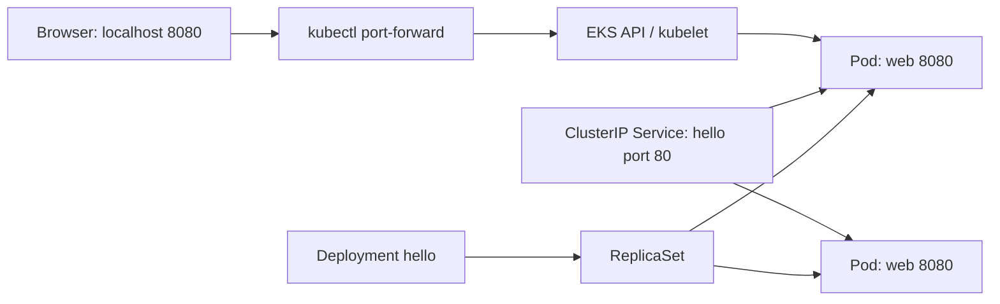

# Practical DevOps Cohort 4 — Deploy, Observe, Recover

**Facilitator:** William Olawuwo — Cloud, DevOps & FinOps  
**Duration:** 2 hours  
**Terminal:** Windows PowerShell or PowerShell 7

Can you deploy a web application, change its version, and recover it when something goes wrong?

This lab builds on Pods, Deployments and rolling updates already covered on Amazon EKS. We use Google's open-source **hello-app**: a small web application that displays its version and hostname. No database or Google Cloud account is needed.

## How to learn with this repository

1. Work in pairs: one person operates, the other predicts and checks. Swap halfway through.
2. Read each question **before** running commands.
3. Try a solution, then open a hint if needed.
4. Record what you observed and explain why it happened.

The YAML files are complete starting points. Inspect them before deploying. Expandable hints contain spoilers; they are learning aids, not hidden or protected answers.

```text
README.md                 Student lab and hints
k8s/deployment.yaml       Web app Deployment
k8s/service.yaml          Internal ClusterIP Service
EVIDENCE.md               Your observation template
.gitignore               Excludes common local credentials and scratch files
```

Download this repository as a ZIP or clone it, then open PowerShell in its root folder. You should see `README.md` and `k8s` when you run `Get-ChildItem`.

## Today's route

| Minutes | Activity | Question to answer |
|---|---|---|
| 0–12 | Welcome and introductions | What would you like to operate confidently? |
| 12–25 | Revision in pairs | Who recreates a deleted Pod? |
| 25–32 | Read the architecture | How does a request reach the app? |
| 32–45 | Access and prerequisite checks | Are we using the correct cluster? |
| 45–65 | Deploy and access | Why do labels matter? |
| 65–85 | Update and undo | What changes a Deployment revision? |
| 85–108 | Scale, self-heal and diagnose | Does replacement mean the same Pod returns? |
| 108–120 | Cleanup and reflection | Which resources still cost money? |

## Before you start

The instructor must provide:

- An **existing EKS cluster** with Ready Linux **amd64** EC2 workers and access to the public image registry.
- Cluster name, AWS region, expected AWS account and your team's namespace.
- An approved AWS login, preferably SSO/federation, and EKS access with permissions limited to your lab namespace.
- A namespace created for each team. Namespace creation is normally an instructor task.
- Capacity for two app Pods, scaling to three, and an additional rollout Pod.

You need AWS CLI v2, kubectl, two PowerShell windows and a browser. Use a kubectl version compatible with the cluster. Do not publish AWS credentials, kubeconfig or account information in your evidence.

**Costs:** the existing EKS control plane, workers, NAT, storage and other AWS resources continue to incur charges. This lab creates no public load balancer. With spare worker capacity, it may need no additional nodes; autoscaling can change that. Deleting the app does not delete the cluster or stop its baseline charges. The instructor owns cloud budgeting and teardown. See [EKS pricing](https://aws.amazon.com/eks/pricing/).

## Revision: explain before opening your terminal

- A Pod disappears. Which object ensures a replacement exists?
- What is the difference between the desired and current replica count?
- Why use a Service when Pods already have IP addresses?
- How do `maxSurge: 1` and `maxUnavailable: 0` affect a rolling update?
- Is a running container necessarily ready to receive traffic?

## Architecture



The Service selects Pods with `app: hello`. For local access, `port-forward service/hello` uses that selection to tunnel to **one Pod** through Kubernetes; it does not demonstrate Service load balancing. The Deployment maintains the desired Pod count through its ReplicaSet.

## 1. Prove you are in the right place

**Think:** what could happen if you deploy into the wrong cluster or namespace?

Set these values using the instructor's details. Every command below runs locally in PowerShell.

```powershell
$env:AWS_REGION = "us-east-1"
$EKS_CLUSTER = "cohort4-eks"
$NS = "c4-team01" # Replace with YOUR assigned namespace
aws --version
kubectl version --client
aws sts get-caller-identity
```

Check the returned account with your instructor. If your login has expired, use your approved login process. For an already configured SSO profile, that may be `aws sso login --profile YOUR_PROFILE`; set `$env:AWS_PROFILE` to that configured profile if required. Do not invent a profile or paste access keys into this repository.

```powershell
aws eks update-kubeconfig --region $env:AWS_REGION --name $EKS_CLUSTER
kubectl config current-context
kubectl -n $NS auth can-i create deployments.apps
kubectl -n $NS auth can-i create services
kubectl -n $NS auth can-i create pods/portforward
kubectl -n $NS get pods
```

Stop if a command fails or the context is wrong. An empty namespace is fine. Namespace-scoped learners may not be allowed to list nodes; the instructor checks node readiness.

**Checkpoint:** correct identity/context, authorized namespace access and no connectivity errors.

## 2. Read the YAML like an engineer

```powershell
Get-Content .\k8s\deployment.yaml
Get-Content .\k8s\service.yaml
```

Before applying anything, find and explain:

- The requested number of Pods and the container's name.
- The image version and its listening port.
- The labels connecting the Deployment, Pods and Service.
- The difference between a readiness probe and a liveness probe.
- Why the Service is `ClusterIP` rather than `LoadBalancer`.
- Why resource requests matter when the cluster has little spare capacity.

<details>
<summary>Hint: ask Kubernetes to explain a field</summary>

```powershell
kubectl explain deployment.spec.replicas
kubectl explain deployment.spec.template.spec.containers.readinessProbe
kubectl explain service.spec.selector
```

Trace the Service selector to the **Pod template** labels, not just the Deployment's metadata.

</details>

## 3. Deploy and collect evidence

**Task:** apply both files to your assigned namespace. Observe the Deployment, ReplicaSet and Pods until the application is ready.

**Predict:** how many Pods will you see? What might delay readiness?

<details>
<summary>Hint 1: discover the command</summary>

Try `kubectl apply --help`. The `-f` option accepts a file or directory; `-n` chooses the namespace.

</details>

<details>
<summary>Hint 2: commands to get started</summary>

```powershell
kubectl -n $NS apply -f .\k8s\
kubectl -n $NS rollout status deployment/hello --timeout=120s
kubectl -n $NS get deployment,replicaset,pods,service
```

If the rollout times out, diagnose the Pods before retrying.

</details>

**Checkpoint:** Deployment has two ready replicas; Service exists. Record Pod names in `EVIDENCE.md`.

## 4. Reach the application

**Think:** can you normally open a ClusterIP address directly from your laptop outside the VPC?

In **PowerShell window B**, set the same namespace (and AWS profile if used), then start the tunnel:

```powershell
$NS = "c4-team01" # Use the same assigned namespace as window A
kubectl -n $NS port-forward service/hello 8080:80 --address=127.0.0.1
```

Keep window B running. In window A:

```powershell
Start-Process "http://127.0.0.1:8080/"
Invoke-RestMethod -Uri "http://127.0.0.1:8080/"
```

**Checkpoint:** record the displayed version and hostname. Explain local port `8080`, Service port `80`, and container port `8080`.

## 5. Release version 2

**Task:** update container `web` to `us-docker.pkg.dev/google-samples/containers/gke/hello-app:2.0`, observe the rollout and inspect its history.

**Predict:** will both old Pods disappear before new ones are ready? What happens if the new image cannot start?

<details>
<summary>Hint 1: command families</summary>

Read `kubectl set image --help`, `kubectl rollout status --help` and `kubectl rollout history --help`. A container's name is not necessarily its Deployment's name.

</details>

<details>
<summary>Hint 2: release and observe</summary>

```powershell
$IMAGE_BASE = "us-docker.pkg.dev/google-samples/containers/gke/hello-app"
kubectl -n $NS annotate deployment hello kubernetes.io/change-cause="Class release: version 2" --overwrite
kubectl -n $NS set image deployment/hello "web=${IMAGE_BASE}:2.0"
kubectl -n $NS rollout status deployment/hello --timeout=120s
kubectl -n $NS rollout history deployment/hello
kubectl -n $NS get replicasets,pods
```

</details>

Stop window B with **Ctrl+C**, then restart the same port-forward command after the rollout. Refresh the browser.

**Checkpoint:** app reports version 2. Explain why a tunnel to an old Pod may need restarting.

**Think deeper:** the file still says `1.0`. What would applying it again do? Imperative changes and Git-tracked desired state can drift.

## 6. Undo the release

**Task:** restore the previous Pod template, wait for readiness, then prove version 1 is serving again.

<details>
<summary>Hint: recovery commands</summary>

```powershell
kubectl -n $NS rollout undo deployment/hello
kubectl -n $NS rollout status deployment/hello --timeout=120s
kubectl -n $NS rollout history deployment/hello
```

Restart the port-forward after Pod replacement and check the response again. Undo creates a new revision using a previous template; it does not erase history.

</details>

**Explain:** would this undo also restore a changed Service selector or reverse a database migration? Why?

## 7. Scale and test self-healing

**Task A:** scale to three replicas. Verify three ready Pods. Inspect rollout history: did scaling create a new Pod-template revision?

<details>
<summary>Hint for scaling</summary>

```powershell
kubectl -n $NS scale deployment/hello --replicas=3
kubectl -n $NS rollout status deployment/hello --timeout=120s
kubectl -n $NS get pods -l app=hello
kubectl -n $NS rollout history deployment/hello
```

</details>

**Task B:** pick one Pod belonging to this app in your namespace. Record its name, delete only that Pod, then watch what happens.

**Predict first:** will the replica count stay at two? Will the replacement have the same name?

<details>
<summary>Hint for the controlled failure</summary>

```powershell
kubectl -n $NS get pods -l app=hello
$PodToDelete = Read-Host "Paste one hello Pod name from the output above"
kubectl -n $NS delete pod $PodToDelete
kubectl -n $NS get pods -l app=hello -w
```

Press **Ctrl+C** when you have observed the replacement. Never select another team's Pod. The ReplicaSet reconciles the desired count; it creates a new Pod rather than reviving the deleted one.

</details>

**Checkpoint:** three ready Pods again, with a replacement name. Record what changed and what remained stable.

## 8. Optional detective challenge: healthy Pods, unreachable Service

Only attempt this in your team's lab namespace if you have time.

1. Stop the port-forward.
2. In `k8s/service.yaml`, change only the Service selector from `app: hello` to `app: mystery`.
3. Apply that file and try starting the tunnel again.
4. Find the mismatch using evidence, then restore the correct selector and reapply the file.

**Question:** why can the Pods be ready while this Service has no matching backends?

<details>
<summary>Hint: compare selection with labels</summary>

```powershell
kubectl -n $NS apply -f .\k8s\service.yaml
kubectl -n $NS get pods --show-labels
kubectl -n $NS describe service hello
kubectl -n $NS get endpointslices -l kubernetes.io/service-name=hello
```

EndpointSlices can take a short time to reconcile. A previously running port-forward may keep working because it already selected a Pod; restart it to observe the broken selection. Restore `app: hello`, reapply and confirm access works.

</details>

## Troubleshooting: collect evidence before changing things

| Symptom | What to investigate |
|---|---|
| AWS credentials expired | Run the approved login process, then check `aws sts get-caller-identity`. |
| API timeout | Instructor checks endpoint access, your current public egress IP allowlist, VPN/routing and DNS. A private laptop address is not a public endpoint allowlist address. |
| `Unauthorized` / `Forbidden` | Check AWS identity, EKS access and namespace permissions. Do not solve it by granting cluster-admin. |
| `Pending` Pods | Describe the Pod: capacity, architecture/node selectors, scheduling or quotas. |
| `ImagePullBackOff` | Check the exact image/tag and worker access to the registry. |
| `CrashLoopBackOff` | Check logs, previous logs and probe failures. |
| Service has no backends | Compare its selector with Pod labels and readiness. |
| Local port already in use | Stop the earlier tunnel or use `8081:80` and browse port 8081. |
| Tunnel stopped after update/deletion | Restart it once replacement Pods are ready. |

Useful investigation commands:

```powershell
kubectl -n $NS get pods -o wide
kubectl -n $NS describe deployment hello
kubectl -n $NS describe pods -l app=hello
kubectl -n $NS logs deployment/hello --tail=50
kubectl -n $NS get events --sort-by=.metadata.creationTimestamp
```

For a restarting container, use `kubectl logs POD_NAME -n $NS --previous` after replacing `POD_NAME` with its actual name. Explain your diagnosis before applying a fix.

## 9. Clean up your app

Stop port-forwarding with **Ctrl+C**. Confirm your context and namespace, then remove only this lab's resources:

```powershell
kubectl config current-context
Write-Output "Cleaning hello resources in namespace: $NS"
kubectl -n $NS delete -f .\k8s\ --ignore-not-found
kubectl -n $NS get deployment,service,pods
```

**Checkpoint:** `hello` Deployment/Service and their Pods are gone. Other resources may remain in a shared namespace. The instructor handles namespace deletion and cloud teardown; never delete a shared cluster as student cleanup.

## Homework: explain your evidence

Complete [EVIDENCE.md](EVIDENCE.md) in your own words. Include:

- A diagram showing Deployment → ReplicaSet → Pods and Service selection.
- Evidence of version 1, version 2 and successful undo.
- Pod names before and after deletion, and your explanation of reconciliation.
- One troubleshooting hypothesis, the evidence you checked and your conclusion.
- What happens if you reapply the original Deployment after scaling to three?
- Two ways to reduce the risk of deploying to the wrong environment.

Do not submit access tokens, kubeconfig, AWS account details or unredacted terminal screenshots. Record actual observations; do not fill in expected results as though you observed them.

## Next session: GitHub Actions + AWS OIDC

CI/CD is **optional follow-up**, outside today's core lab. We use **GitHub Actions**, not Jenkins.

```text
GitHub commit → Actions → short-lived AWS role via OIDC
                           ├─ build and push image to ECR
                           └─ deploy image to this team's EKS namespace
```

Before enabling deployment automation, the instructor must configure:

- A GitHub OIDC trust policy restricted to the intended repository and branch or protected environment, with the correct audience.
- ECR push permissions limited to the intended repository; `ecr:GetAuthorizationToken` is the separate registry authentication permission.
- EKS cluster discovery and namespace-scoped deployment access, without administrator policies or static AWS secrets.
- A runner that can reach the EKS API. A cluster allowing only your laptop's public IP will not automatically allow a hosted GitHub runner.
- Workflow permissions such as `contents: read` and `id-token: write`, immutable image tags, rollout verification and environment controls.

**Design question:** what is the difference between being allowed to assume an AWS role and being allowed to change a Kubernetes Deployment?

This student repository intentionally contains no automatically triggered deployment workflow. Build the reviewed workflow together next session.

## References and learning path

| Resource | Use it for |
|---|---|
| [Kubernetes Basics — official beginner tutorials](https://kubernetes.io/docs/tutorials/kubernetes-basics/) | Start here: deploy, explore, expose, scale and update. |
| [Kubernetes overview](https://kubernetes.io/docs/concepts/overview/) | Understand the platform and its core ideas. |
| [kubectl Quick Reference / Cheat Sheet](https://kubernetes.io/docs/reference/kubectl/quick-reference/) | Find command patterns during challenges. |
| [Deployments](https://kubernetes.io/docs/concepts/workloads/controllers/deployment/) | Study revisions, rolling updates and rollback. |
| [Services](https://kubernetes.io/docs/concepts/services-networking/service/) | Understand selectors, ports and stable access. |
| [Port-forward tutorial](https://kubernetes.io/docs/tasks/access-application-cluster/port-forward-access-application-cluster/) | Understand local access and its limits. |
| [hello-app source](https://github.com/GoogleCloudPlatform/kubernetes-engine-samples/tree/main/quickstarts/hello-app) | Inspect the sample application used here. |
| [GitHub Actions: OIDC in AWS](https://docs.github.com/en/actions/how-tos/secure-your-work/security-harden-deployments/oidc-in-aws) | Prepare short-lived CI authentication. |
| [EKS access entries](https://docs.aws.amazon.com/eks/latest/userguide/creating-access-entries.html) | Understand how AWS identities receive cluster access. |
| [ECR image push permissions](https://docs.aws.amazon.com/AmazonECR/latest/userguide/image-push-iam.html) | Scope the future pipeline's registry permissions. |

Some upstream examples use Bash. This lab's local commands use PowerShell: `$NAME = "value"` for variables, `$env:NAME` for environment variables, and `Invoke-RestMethod` for HTTP requests. A Bash trailing `\` is not PowerShell line continuation. Commands here use single lines to avoid that difference.

**Course alignment:** YAML, namespaces, Deployments, Services and managed Kubernetes; registry and pipeline integration follows next. The sample application is maintained by GoogleCloudPlatform in the Apache-2.0-licensed `kubernetes-engine-samples` repository; consult its upstream license. These lab materials do not include the original syllabus or redistribute application source code.

**Validation note:** materials were reviewed locally; successful execution on your teaching cluster must be confirmed during instructor rehearsal.
# Practical_Devops04
